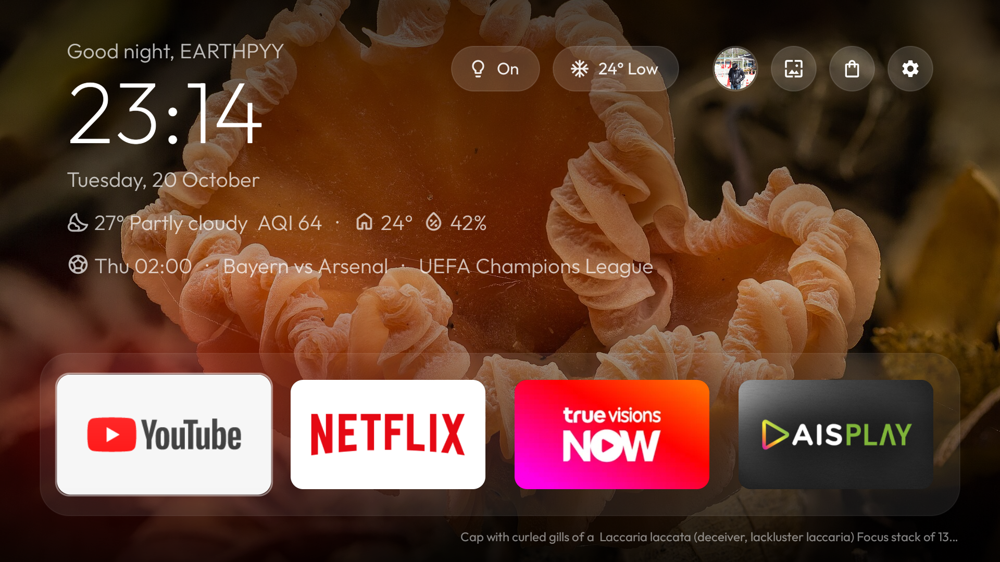

# google-tv-launcher

A calm, Apple TV style home screen for the **Chromecast with Google TV (4K, Android 14)**. No ads, no recommendations, no autoplaying trailers: just your apps, the time, and (if you like) your home.



Built on top of [Gathin23/cleanyourtv](https://github.com/Gathin23/cleanyourtv).

## What you get

- 🖤 **Pitch black and quiet.** One glass focus highlight, a big clock in [Outfit](https://github.com/Outfitio/Outfit-Fonts) (SIL OFL), no blur, no video, no background polling.
- 📺 **A four-app dock** for your favourites, with a 4-column grid of everything else below it. Hold OK on any app to dock, move or hide it.
- 👋 **Profiles.** Each person gets their own dock, hidden apps and wallpaper, with a "Who's watching?" picker and their [Gravatar](https://gravatar.com) name and picture.
- 🏠 **Home Assistant, optional.** Weather, air quality and indoor climate at a glance, plus one-press light and AC controls.
- 🎮 **Remote-friendly navigation** that never wraps or jumps somewhere unexpected.

## Quick start

You'll need [mise](https://mise.jdx.dev) (it pins Java 17) and the Android SDK (platform-tools, platform 34).

```sh
cp .env.example .env   # fill in your values
mise install
./scripts/pair.sh      # pair with the TV once (see below)
./scripts/build-install.sh
```

That's it: the launcher is built, installed, set as the home app and as the screensaver.

<details>
<summary>About <code>.env</code> and the signing keystore</summary>

`.env` holds the TV address, the release keystore path and passwords, the profiles and the Home Assistant settings. It is gitignored and never committed.

The keystore lives outside the repo in `~/.keystores/googletvlauncher.jks`. Copy that file and `.env` to any other machine you build on, otherwise reinstalling fails with a signature mismatch.

To create a keystore from scratch:

```sh
keytool -genkeypair -keystore ~/.keystores/googletvlauncher.jks -alias googletvlauncher \
  -keyalg RSA -keysize 2048 -validity 10000 -dname "CN=googletvlauncher"
```

</details>

## Connecting to the TV

The TV uses **Wireless debugging** (paired over TLS), so port 5555 is never opened.

1. On the TV, go to **Settings → System → Developer options → Wireless debugging** and make sure it's **on**. Android turns it off whenever Wi-Fi drops, so check here first if things stop working.
2. Choose **Pair device with pairing code** and leave that screen open.
3. On your Mac, run `./scripts/pair.sh` and enter the port shown under the code (`<tv-ip>:<port>`) and the 6-digit code.

**Troubleshooting**

- `adb` says "No route to host" even though the TV is reachable? macOS Local Network privacy is blocking it. Allow your terminal app in **System Settings → Privacy & Security → Local Network**, then restart the terminal.
- Connect port looks stale? Run `adb kill-server` and pair again.

## Making it yours

Everything is set in `.env` (see [`.env.example`](.env.example)), then run `./scripts/build-install.sh`. Values are baked into the APK at build time.

### Profiles

Add one block per person: `PROFILE_1_EMAIL`, `PROFILE_2_EMAIL`, and so on. They're read in order until the first missing one, and at least one is required (the build fails otherwise).

Names and avatars come from each email's [Gravatar](https://gravatar.com) and are cached on the TV for a day. Until they load, or if there's no Gravatar, you'll see a grey silhouette and the part of the email before `@`. The greeting becomes "Good evening, <name>".

Per profile (`PROFILE_n_…`):

| Setting | What it does |
|---|---|
| `PROFILE_n_FOOTBALL_TEAM_IDS` | Favourite teams for the [football line](#football), comma-separated (e.g. `57,64`). Empty means no football line. |

With two or more profiles:

- **Who's watching?** shows up on a cold start, and when the TV wakes from at least 5 minutes of standby with the home screen in front. Left/Right to pick, OK to choose. Back does nothing.
- **The profile button** (your avatar, left of the wallpaper button) switches to the next profile.

Switching profiles puts focus on the first dock app.

### Dock and hidden apps

These are set on the TV, not in `.env`, and each profile has its own. A new profile starts with an empty dock (a dashed placeholder) and nothing hidden.

Hold OK on any app for about half a second to open its menu:

| App in | Menu |
|---|---|
| Grid | **Add to dock** (up to 4 apps), **Hide** |
| Dock | **Move** (Left/Right to shift it, OK to keep, Back or Home to cancel), **Remove from dock** |
| Hidden apps | **Unhide** |

While any app is hidden, a small **Hidden apps** button sits under the grid. OK on it shows them, dimmed, underneath. They close again on Home, on a profile switch and in standby. Play Store and Settings never show in the grid; they have their own buttons.

The layout lives in the launcher's app data, so uninstalling the launcher (or a signature change) resets it. An uninstalled app keeps its dock place or hidden state, and gets it back if reinstalled.

### Wallpaper

Also set on the TV, per profile. Press the **wallpaper button** (left of Play Store) and a strip of choices takes the dock's place. Left/Right preview each one behind the home screen, OK keeps it, Back (or Home) puts the old one back.

- **Static:** Black (the default) and six dark gradients.
- **Feeds:** a new picture every day from [Bing](https://www.bing.com), [NASA Image of the Day](https://www.nasa.gov/image-of-the-day/) or [Wikimedia Commons](https://commons.wikimedia.org/wiki/Commons:Picture_of_the_day). None need a key. Its title and credit sit small under the dock, and a dark gradient keeps the text readable.

Only the chosen feed is downloaded, sized to the screen and cached on the TV. It's checked when the home screen appears, at most every 3 hours, never in the background; opening the strip checks all three. If a feed can't be reached, its last picture stays; before the first one loads, it shows black.

### Home Assistant

Set `HASS_URL` and a long-lived access token in `HASS_TOKEN` (HA profile → Security). Without both, none of this appears.

- **Glance line** under the date: outside weather from `HASS_WEATHER` (icon, temperature and condition) and `HASS_AQI` (amber above 100, red above 150), then inside temperature and humidity from `HASS_INSIDE_TEMPERATURE` and `HASS_INSIDE_HUMIDITY`. Icons are [Material Symbols](https://github.com/google/material-design-icons) (Apache 2.0).
- **Lights button** (`HASS_LIGHT`, any light or switch): OK turns it on or off.
- **AC button** (`HASS_CLIMATE`): OK opens a panel. Up/Down pick Power, Temperature or Fan. OK toggles power. Left/Right change the temperature (`HASS_CLIMATE_MIN_TEMP` to `HASS_CLIMATE_MAX_TEMP`) and fan speed (`HASS_CLIMATE_FAN_MODES`, e.g. `auto,low,mid:Medium,high`). Changes are sent 500 ms after your last press. Back closes it.

Leave any entity empty to hide that part; an unavailable entity shows `–`. States are fetched when the home screen appears and after each action, never in the background. If Home Assistant can't be reached, the last values stay on screen, dimmed.

### Football

A line under the glance line follows your favourite teams, using [football-data.org](https://www.football-data.org). Get a free API key at [football-data.org/client/register](https://www.football-data.org/client/register) and put it in `FOOTBALL_DATA_TOKEN`, then list each profile's teams in `PROFILE_n_FOOTBALL_TEAM_IDS`. Find a team's ID on the [coverage page](https://www.football-data.org/coverage). The free plan covers the Premier League, Championship, La Liga, Serie A, Bundesliga, Ligue 1, Eredivisie, Primeira Liga, Brasileirão, Champions League, World Cup and Euros.

With several teams, the line shows just one match, the one that matters most:

| When | The line |
|---|---|
| A match is on | `LIVE · Arsenal 1–0 Chelsea` |
| Up to about 12 hours after the final whistle | `FT · Arsenal 2–1 Chelsea` |
| Otherwise, the next kick-off in the coming 30 days | `Sat 22:30 · Arsenal vs Chelsea · Premier League` (or `Today`, `Tomorrow`, `2 Nov`, and `in 45 min` in the last hour) |

Matches are fetched when the home screen appears and at kick-off, then every minute while a match is live and the home screen is in front; never in the background. That's one request per team, well within the free plan's 10 a minute. Free plan live scores run a few minutes behind. With nothing to show, or a wrong ID or key, the line is hidden; if football-data.org can't be reached, the last match stays on screen, dimmed.

## Getting around

- Up/Down move exactly one row. Up from the dock goes to the top bar; Down goes into the grid.
- Left/Right stop at the ends of a row. They never wrap or fall through.
- Back returns to the dock, and so does pressing Home while already home.
- Apps open when you let go of OK; holding it opens the app's menu instead.
- The last focused tile is remembered when you come back from an app.

## Scripts

| Script | What it does |
|---|---|
| `scripts/pair.sh` | Pair and connect over Wireless debugging |
| `scripts/tv.sh` | Run any adb command against the TV (finds the current connect port for you) |
| `scripts/build-install.sh` | Build the signed release APK, install it, set it as home and as the screensaver |
| `scripts/backup.sh` | Save package lists, `getprop` and all settings to `backup/<timestamp>/` (gitignored) |
| `scripts/restore.sh` | Re-enable everything in `debloat-list.txt` and `launcher-swap-list.txt` and restore the stock home and ambient mode |

## What was changed on the TV

- **Uninstalled** (reinstall any of them from the Play Store): Disney+ Hotstar, DAZN, Twitch, Viu, Doonung.
- **Disabled**: everything in [`debloat-list.txt`](debloat-list.txt) (Google TV/Play Movies, Play Games, ambient mode, feedback/telemetry, print spooler, TalkBack, calendar) and [`launcher-swap-list.txt`](launcher-swap-list.txt) (stock launcher, setup wizard).
- **Kept**: Google Assistant, Cast, firmware updates, remote/TV control setup (`tv.axel`), and every system module.

Changed your mind about an app? Re-enable it with:

```sh
./scripts/tv.sh shell pm enable <package>
```

Or run `scripts/restore.sh` to undo everything at once.

<details>
<summary>Why the setup wizard is disabled</summary>

On Google TV, `com.google.android.tungsten.setupwraith` grabs HOME as soon as the stock launcher is disabled. Disabling it deletes every Wi-Fi network it created during first setup, so before disabling it the Wi-Fi networks were forgotten and re-joined in Settings (now owned by the system). Check with:

```sh
./scripts/tv.sh shell "dumpsys wifi | grep -o 'cname=[^ ]*' | sort | uniq -c"
```

</details>

## Credits

- [Gathin23/cleanyourtv](https://github.com/Gathin23/cleanyourtv), the starting point for this launcher.
- Screenshot wallpaper: [*Gewone fopzwam (Laccaria laccata)*](https://commons.wikimedia.org/wiki/File:Gewone_fopzwam_(Laccaria_laccata)._Locatie,_Paddenstoelenreservaat._14-10-2025._(d.j.b).jpg) by Dominicus Johannes Bergsma, [CC BY-SA 4.0](https://creativecommons.org/licenses/by-sa/4.0).
- Built with the help of [Claude](https://claude.ai) and [Claude Code](https://claude.com/claude-code) by Anthropic.

## License

See [LICENSE](LICENSE).
